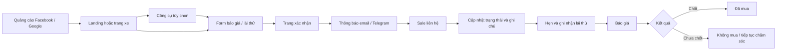

# Toyota Kon Tum — hệ thống thiết kế và khung giao diện

Giao diện ưu tiên điện thoại, dùng chung ngôn ngữ hình ảnh cho website và CRM.
Các nội dung sản phẩm, giá, ưu đãi, hình ảnh và liên hệ chưa được xác nhận
không được thay bằng dữ liệu minh họa. Vùng chưa có tài sản dùng khung trống,
thông tin thiếu hiển thị placeholder hoặc trạng thái “Chưa có dữ liệu”.

## 1. Hệ thống thiết kế

### Màu sắc và tương phản

| Vai trò | Màu | Cách sử dụng |
|---|---|---|
| Đỏ nhấn Toyota | `#8F1119` | CTA chính, liên kết và focus; tương phản trắng khoảng 8:1 |
| Đỏ nền nhạt | `#FEF2F2` | Nền nhấn nhẹ, thông báo quan trọng |
| Than | `#101828` | Tiêu đề, header/footer đậm |
| Chữ phụ | `#475569` | Mô tả, nhãn và chú thích trên nền trắng |
| Viền | `#E3E7ED` | Phân tách thẻ, bảng và trường nhập |
| Canvas | `#F6F7F9` | Nền khu vực phụ |
| Thành công | `#166534` trên `#F0FDF4` | Xác nhận và trạng thái hoàn tất |
| Cảnh báo | `#78350F` trên `#FFFBEB` | Nhắc kiểm tra, dữ liệu chờ |
| Lỗi | `#991B1B` trên `#FEF2F2` | Lỗi nhập liệu và lỗi lưu |

Màu thương hiệu do admin chọn được tự làm tối đến khi đạt tương phản ít nhất
4.5:1 với chữ trắng. Các nội dung nhỏ dùng cỡ tối thiểu 12px và màu chữ đậm
đủ tương phản; màu chỉ báo trạng thái luôn đi kèm nhãn chữ.

### Chữ, lưới và kích thước

- Font: Be Vietnam Pro, hỗ trợ tiếng Việt; system UI là font dự phòng.
- H1: `clamp(32px, 4vw, 60px)`, đậm 700–800; H2: `clamp(24px, 2.5vw, 36px)`;
  H3: 20–24px; body: 16px/1.6; caption: 12–14px.
- Khoảng cách theo bậc 8px; vùng trang tối đa 1280px; khoảng cách section
  48/64/80px theo viewport.
- Bo góc: trường/nút 12px, thẻ 16–24px; bóng mềm, viền mảnh.
- Breakpoints thiết kế: 390px, 768px, 1280px, 1440px.
- Nút, ô nhập, điều khiển tab và vùng thao tác tối thiểu 44px; focus có viền
  rõ, disabled giảm tương phản nhưng vẫn đọc được, lỗi dùng viền đỏ và thông báo.

### Thành phần và trạng thái

- Nút: chính (đỏ đậm, một CTA nổi bật mỗi màn), phụ (trắng/viền), chữ (nền
  trong); có hover, focus-visible, disabled và đang gửi.
- Trường nhập/select: nền trắng, viền xám; focus có outline; lỗi có viền đỏ;
  disabled có nền xám; checkbox có vùng nhấn bao quanh nhãn.
- Thẻ xe: khung ảnh tỉ lệ 16:10, phân khúc, tên, giá xác nhận hoặc “Liên hệ”,
  một liên kết chi tiết. Chưa có ảnh thì hiển thị khung chờ ảnh.
- Khuyến mãi: nội dung/điều kiện/thời hạn lấy từ bản ghi đã xuất bản; không
  hiển thị đếm ngược nếu thiếu thời hạn thật.
- Badge: Mới, Đã gọi, Hẹn lái thử, Đã lái thử, Báo giá, Đàm phán, Đã mua,
  Không mua, Sai thông tin, Trùng; màu badge luôn kèm chữ.
- Bảng: header xám nhạt, hàng có đường phân cách; bảng so sánh mobile cuộn
  ngang và ghim cột thông tin đầu tiên.
- Tab, breadcrumb, phân trang, modal xác nhận và toast dùng cùng viền, góc,
  trạng thái focus. Trạng thái rỗng, tải, lỗi lưu và chưa lưu có lớp hiển thị
  riêng; chuyển động tắt theo `prefers-reduced-motion`.

## 2. Khách hàng — khung mobile 390px

### Web / Trang chủ / Mobile

```text
┌──────────────────────────────┐
│ Hotline · Zalo · địa chỉ →  │
├──────────────────────────────┤
│ Logo/placeholder      Menu   │
├──────────────────────────────┤
│ Hero slider (tối đa 4 slide) │
│ Nội dung đã duyệt            │
│ [Nhận báo giá]               │
│ Khung ảnh 4:3 · chấm · dừng  │
├──────────────────────────────┤
│ Khám phá xe · lọc kiểu dáng  │
│ Thẻ xe cuộn · giá từ [GIÁ]   │
│ Ưu đãi có điều kiện + hạn    │
│ 5 công cụ mua xe             │
│ Dịch vụ · tin tức · lead form│
│ Showroom / bản đồ placeholder│
├──────────────────────────────┤
│ Footer + chính sách          │
├──────────────────────────────┤
│ Gọi │ Zalo │ Nhận báo giá    │  thanh cố định
└──────────────────────────────┘
```

### Web / Danh mục xe / Mobile

```text
┌──────────────────────────────┐
│ Breadcrumb + tiêu đề         │
│ [Bộ lọc xe]  Số kết quả      │
│ Thẻ xe 1                     │
│ Thẻ xe 2                     │
│ Phân trang                   │
└──────────────────────────────┘
             ↓ mở bộ lọc
┌──────────────────────────────┐
│ Lớp phủ                      │
│ Bottom sheet: dòng, giá,     │
│ số chỗ, nhiên liệu           │
│ [Lọc xe] [Xóa bộ lọc]        │
└──────────────────────────────┘
```

### Web / Chi tiết xe / Mobile

```text
┌──────────────────────────────┐
│ Breadcrumb                   │
│ Gallery ảnh / khung chờ ảnh  │
│ Dòng xe · Tên mẫu xe         │
│ [Nhận báo giá]               │
│ [Đăng ký lái thử]            │
│ Bảng so sánh phiên bản  →    │
│ Tab cuộn: thông tin/thông số │
│ Ưu đãi đã xác nhận           │
│ Xe liên quan                 │
└──────────────────────────────┘
│ Gọi │ Zalo │ Nhận báo giá    │
```

Bảng phiên bản dùng cuộn ngang, ghim cột thuộc tính. Giá chưa có hiển thị
“Liên hệ”; số chỗ/nhiên liệu thiếu hiển thị “Chưa có dữ liệu”. Không có lựa
chọn màu khi đại lý chưa cung cấp dữ liệu màu.

### Web / Dự toán lăn bánh / Mobile

```text
┌──────────────────────────────┐
│ Tiêu đề + giải thích ước tính│
│ Form: khu vực, phiên bản, giá│
│ [Tính chi phí]               │
│ Kết quả: từng loại phí       │
│ Tổng ước tính + lưu ý        │
│ [Nhận tư vấn]                │
└──────────────────────────────┘
```

### Web / Tính trả góp / Mobile

```text
┌──────────────────────────────┐
│ Tiêu đề + điều kiện tính     │
│ Phiên bản / giá              │
│ Trả trước / kỳ hạn có cấu hình│
│ [Tính khoản trả]             │
│ Kết quả tháng + lãi          │
│ [Nhận tư vấn]                │
└──────────────────────────────┘
```

### Web / So sánh phiên bản / Mobile

```text
┌──────────────────────────────┐
│ ← [TÊN XE] · So sánh         │
│ [Phiên bản A⌄] [Thêm⌄]       │
├───────────────┬──────────────┤
│ Thông tin     │ Phiên bản A  │
│ Giá           │ [GIÁ]/Liên hệ│
│ Số chỗ        │ [DỮ LIỆU]    │
│ Nhiên liệu    │ [DỮ LIỆU]    │
└───────────────┴──────────────┘
    ← cuộn ngang, cột trái ghim →
```

Chỉ so sánh giá, số chỗ và nhiên liệu đã có dữ liệu; không tự suy diễn trang
bị hoặc màu. Tối đa ba phiên bản mỗi lần so sánh.

### Web / Form báo giá hoặc lái thử / Mobile

```text
┌──────────────────────────────┐
│ Breadcrumb + nhu cầu đã chọn │
│ Họ tên *                     │
│ Số điện thoại *              │
│ Dòng xe                      │
│ Khu vực *                    │
│ Thông tin bổ sung (mở rộng)  │
│ Đồng ý xử lý dữ liệu *       │
│ [Gửi yêu cầu]                │
└──────────────────────────────┘
```

Lỗi được đặt cạnh form và trường sai có viền đỏ. Đang gửi khóa nút; thành công
đi đến trang xác nhận. Form vẫn có giới hạn tần suất và honeypot phía server.

### Web / Cảm ơn / Mobile

```text
┌──────────────────────────────┐
│             ✓                │
│ Đã ghi nhận yêu cầu          │
│ Đại lý đã nhận thông tin.    │
│                              │
│ 1. Tiếp nhận                 │
│ 2. Kiểm tra nhu cầu          │
│ 3. Tư vấn bước tiếp theo     │
│                              │
│ [Xem các mẫu xe]             │
└──────────────────────────────┘
```

### Web / Landing chiến dịch / Mobile

```text
┌──────────────────────────────┐
│ [Logo/placeholder] [Trang chủ]│
├──────────────────────────────┤
│ [Tên chiến dịch]             │
│ Tiêu đề và nội dung duyệt    │
│ [ƯU ĐÃI] · điều kiện · hạn  │
│ Khung ảnh có bản quyền       │
│ [Nhận báo giá]               │
├──────────────────────────────┤
│ Form báo giá / lái thử       │
│ Họ tên *                     │
│ Số điện thoại *              │
│ Dòng xe · Khu vực *          │
│ [ ] Đồng ý xử lý dữ liệu     │
│ [Gửi yêu cầu]                │
└──────────────────────────────┘
```

## 3. Khách hàng — khung desktop 1360px

Các khung dưới đây là wireframe đích cho desktop; nội dung sản phẩm và hình ảnh
chỉ lấy từ dữ liệu đã được đại lý duyệt.

### Web / Trang chủ / Desktop

```text
┌────────────────────────────────────────────────────────────────────────────┐
│ [Địa chỉ]                                    Hotline [HOTLINE] · Zalo [ZALO]│
├────────────────────────────────────────────────────────────────────────────┤
│ [Logo placeholder] Dòng xe  Ưu đãi  So sánh  Công cụ  Dịch vụ  [Lái thử]   │
├────────────────────────────────────────────────────────────────────────────┤
│ HERO slider: nội dung + [Nhận báo giá]       │ Khung ảnh 4:3              │
│                     [‹] ● ○ ○ [›] [Tạm dừng]                            │
├────────────────────────────────────────────────────────────────────────────┤
│ Khám phá xe [Tất cả] [SUV] [Sedan] [Đa dụng] [Bán tải] [Hybrid]          │
│                              [Thẻ xe] [Thẻ xe] [Thẻ xe]                   │
├────────────────────────────────────────────────────────────────────────────┤
│ Ưu đãi đang áp dụng: tiêu đề · điều kiện · hạn thật · [Tìm hiểu]         │
├────────────────────────────────────────────────────────────────────────────┤
│ Công cụ mua xe: [Danh mục] [Lăn bánh] [Trả góp] [Lái thử] [Báo giá]       │
├────────────────────────────────────────────────────────────────────────────┤
│ Dịch vụ & Công nghệ · Tin tức & Khuyến mãi                                │
├────────────────────────────────────────────────────────────────────────────┤
│ Đăng ký lái thử / báo giá: form nhúng 2 cột, consent và [Gửi yêu cầu]     │
├────────────────────────────────────────────────────────────────────────────┤
│ Showroom / bản đồ placeholder đến khi liên kết được xác nhận              │
├────────────────────────────────────────────────────────────────────────────┤
│ Footer: thông tin đại lý · liên kết · mạng xã hội · chính sách           │
└────────────────────────────────────────────────────────────────────────────┘
```

### Web / Danh mục xe / Desktop

```text
┌────────────────────────────────────────────────────────────────────────────┐
│ Breadcrumb: Trang chủ / Xe Toyota                                         │
│ Xe Toyota                                             Sắp xếp: [Mới nhất⌄]│
├─────────────────────┬──────────────────────────────────────────────────────┤
│ BỘ LỌC              │ 12 kết quả                                          │
│ Dòng xe      [⌄]    │ [Thẻ xe]           [Thẻ xe]           [Thẻ xe]      │
│ Kiểu dáng    [⌄]    │ Ảnh/placeholder    Ảnh/placeholder    Ảnh/placeholder│
│ Giá          [⌄]    │ Tên mẫu · Liên hệ  Tên mẫu · Liên hệ  Tên mẫu      │
│ Số chỗ       [⌄]    │ [Chi tiết]         [Chi tiết]         [Chi tiết]    │
│ Nhiên liệu   [⌄]    │                                                      │
│ [Áp dụng] [Xóa]     │             [1] [2] [3] [Tiếp]                      │
└─────────────────────┴──────────────────────────────────────────────────────┘
```

### Web / Chi tiết xe / Desktop

```text
┌────────────────────────────────────────────────────────────────────────────┐
│ Breadcrumb: Trang chủ / Xe / [TÊN XE]                                     │
├─────────────────────────────────────────────┬──────────────────────────────┤
│ Gallery: ảnh đã duyệt / khung chờ ảnh       │ Dòng xe · [TÊN XE]          │
│ [ảnh chính 4:3]                             │ Giá: [GIÁ] / Liên hệ        │
│ [thumbnail] [thumbnail] [video nếu có]      │ Ưu đãi: [ƯU ĐÃI] + điều kiện│
│                                             │ [Nhận báo giá]              │
│                                             │ [Đăng ký lái thử]           │
├─────────────────────────────────────────────┴──────────────────────────────┤
│ Tổng quan | Phiên bản | Thông số | Thư viện | Ưu đãi                      │
├────────────────────────────────────────────────────────────────────────────┤
│ Bảng phiên bản · thông số có nguồn dữ liệu · tính trả góp rút gọn          │
├────────────────────────────────────────────────────────────────────────────┤
│ Xe cùng phân khúc: [Thẻ xe]                 [Thẻ xe]                       │
└────────────────────────────────────────────────────────────────────────────┘
```

### Web / Dự toán lăn bánh / Desktop

```text
┌────────────────────────────────────────────────────────────────────────────┐
│ Dự toán chi phí lăn bánh · Kết quả chỉ mang tính tham khảo                │
├───────────────────────────────────────┬────────────────────────────────────┤
│ Xe / phiên bản       [Chọn⌄]          │ KẾT QUẢ ƯỚC TÍNH                  │
│ Khu vực              [Kon Tum⌄]       │ Giá xe                    [GIÁ]   │
│ [Tính chi phí]                        │ Lệ phí / phí cấu hình             │
│                                       │ Tổng ước tính              [TỔNG] │
│                                       │ [Gửi yêu cầu tư vấn]              │
└───────────────────────────────────────┴────────────────────────────────────┘
```

### Web / Tính trả góp / Desktop

```text
┌────────────────────────────────────────────────────────────────────────────┐
│ Tính khoản trả góp · dùng giá và lãi suất đại lý cấu hình                 │
├───────────────────────────────────────┬────────────────────────────────────┤
│ Phiên bản             [Chọn⌄]         │ KẾT QUẢ                           │
│ Giá xe                [GIÁ]           │ Khoản vay                  [—]    │
│ Trả trước         [thanh trượt]       │ Khoản trả hàng tháng        [—]    │
│ Kỳ hạn             [tháng⌄]           │ Lãi suất áp dụng       [chưa có]  │
│ Lãi suất           [đại lý nhập]      │ [Nhận tư vấn]                    │
│ [Tính khoản trả]                      │                                   │
└───────────────────────────────────────┴────────────────────────────────────┘
```

### Web / So sánh phiên bản / Desktop

```text
┌────────────────────────────────────────────────────────────────────────────┐
│ So sánh phiên bản [TÊN XE]             [Chọn phiên bản⌄] [Thêm phiên bản] │
├─────────────────┬───────────────────┬───────────────────┬────────────────┤
│ Thông tin       │ Phiên bản A        │ Phiên bản B        │ Phiên bản C    │
│ Giá             │ [GIÁ]/Liên hệ     │ [GIÁ]/Liên hệ     │ [GIÁ]/Liên hệ │
│ Số chỗ          │ [DỮ LIỆU]          │ [DỮ LIỆU]          │ [DỮ LIỆU]     │
│ Nhiên liệu      │ [DỮ LIỆU]          │ [DỮ LIỆU]          │ [DỮ LIỆU]     │
└─────────────────┴───────────────────┴───────────────────┴────────────────┘
```

### Web / Form báo giá hoặc lái thử / Desktop

```text
┌────────────────────────────────────────────────────────────────────────────┐
│ Trang chủ / Đăng ký tư vấn                                                │
├──────────────────────────────────────────────┬─────────────────────────────┤
│ FORM                                         │ SAU KHI GỬI                 │
│ Họ tên *                 [________________]  │ 1. Đại lý tiếp nhận        │
│ Số điện thoại *          [________________]  │ 2. Nhân viên kiểm tra      │
│ Dòng xe                  [Chọn xe⌄]          │    thông tin               │
│ Khu vực *                [Chọn khu vực⌄]     │ 3. Liên hệ theo yêu cầu    │
│ Thông tin thêm           [Mở rộng⌄]          │                             │
│ [ ] Đồng ý xử lý dữ liệu                 │                             │
│ [Gửi yêu cầu]                                │                             │
└──────────────────────────────────────────────┴─────────────────────────────┘
```

### Web / Cảm ơn / Desktop

```text
┌────────────────────────────────────────────────────────────────────────────┐
│                          ┌─────────────────────────────┐                   │
│                          │ ✓  Đã ghi nhận yêu cầu      │                   │
│                          │ Đại lý sẽ xem thông tin.    │                   │
│                          │                             │                   │
│                          │ 1. Tiếp nhận                │                   │
│                          │ 2. Kiểm tra nhu cầu         │                   │
│                          │ 3. Tư vấn bước tiếp theo    │                   │
│                          │ [Xem các mẫu xe]            │                   │
│                          └─────────────────────────────┘                   │
└────────────────────────────────────────────────────────────────────────────┘
```

### Web / Landing chiến dịch / Desktop

```text
┌────────────────────────────────────────────────────────────────────────────┐
│ Logo/placeholder                                          [Trang chủ]      │
├───────────────────────────────────────┬────────────────────────────────────┤
│ [Tên chiến dịch]                      │ Ảnh chiến dịch có bản quyền       │
│ Tiêu đề và nội dung đã duyệt          │                                    │
│ Điều kiện / hạn nếu đã xác nhận       │                                    │
│ [Nhận báo giá]                        │                                    │
├───────────────────────────────────────┴────────────────────────────────────┤
│ Form báo giá / lái thử · consent · [Gửi yêu cầu]                           │
│ Chính sách bảo mật                                                         │
└────────────────────────────────────────────────────────────────────────────┘
```

## 4. Quản trị — desktop 1360px, lead trên mobile

Các khung này mô tả mục tiêu bố cục. Filament hiện tại cung cấp phần quản trị
chung; các khung CRM tuỳ biến dưới đây chưa đồng nghĩa với việc mọi màn hình
đã được dựng thành trang riêng.

### Admin / Đăng nhập + OTP / Desktop

```text
┌────────────────────────────────────────────────────────────────────────────┐
│                            [Logo đại lý nếu có]                            │
│                    ┌──────────────────────────────┐                        │
│                    │ Đăng nhập quản trị           │                        │
│                    │ Email      [______________]  │                        │
│                    │ Mật khẩu   [______________]  │                        │
│                    │ [Đăng nhập]                  │                        │
│                    │ Mã OTP     [______] (bước 2) │                        │
│                    │ [Xác thực]  [Lỗi xác thực]   │                        │
│                    └──────────────────────────────┘                        │
└────────────────────────────────────────────────────────────────────────────┘
```

### Admin / Dashboard / Desktop

```text
┌──────────────┬─────────────────────────────────────────────────────────────┐
│ Sidebar      │ Toyota Kon Tum CRM     [Tìm kiếm]       [Tài khoản⌄]       │
│ Dashboard    ├─────────────────────────────────────────────────────────────┤
│ Leads        │ [Lead mới hôm nay] [Quá hạn] [Tỉ lệ lái thử] [Tỉ lệ chốt] │
│ Xe           ├───────────────────────────────────┬─────────────────────────┤
│ Ưu đãi       │ Lead theo ngày (dữ liệu thực)     │ Nguồn Facebook/Google  │
│ Nội dung     │ [Biểu đồ]                         │ [Biểu đồ]               │
│ Cài đặt      ├───────────────────────────────────┴─────────────────────────┤
│              │ Việc cần gọi: khách · xe · hạn xử lý · [Mở lead]           │
└──────────────┴─────────────────────────────────────────────────────────────┘
```

### Admin / Danh sách lead / Desktop

```text
┌──────────────┬─────────────────────────────────────────────────────────────┐
│ Sidebar      │ Leads                               [+ Tìm kiếm toàn cục]  │
│              ├─────────────────────────────────────────────────────────────┤
│              │ Tìm SĐT [________] Trạng thái [⌄] Nguồn [⌄] Xe [⌄]        │
│              │ Nhân viên [⌄] Ngày [____—____] [Lọc] [Xuất CSV]           │
│              ├─────────────────────────────────────────────────────────────┤
│              │ [ ] Tên       SĐT       Xe      Nguồn    Trạng thái  Sale  │
│              │ [ ] [KHÁCH]   [SĐT]     [XE]    Google   Mới         [—]   │
│              │ [ ] [KHÁCH]   [SĐT]     [XE]    Meta     Đã gọi      [—]   │
│              ├─────────────────────────────────────────────────────────────┤
│              │ Chọn nhiều: [Gán nhân viên⌄] [Đổi trạng thái⌄] [Áp dụng] │
│              │ [Trang trước] 1 / N [Trang sau]                            │
└──────────────┴─────────────────────────────────────────────────────────────┘
```

### Admin / Chi tiết lead / Mobile

```text
┌──────────────────────────────┐
│ ← Leads          Trạng thái⌄ │
├──────────────────────────────┤
│ [TÊN KHÁCH] · [MỚI]          │
│ [SỐ ĐIỆN THOẠI]              │
│ [Gọi] [Zalo nếu hợp lệ]      │
│ Xe [XE] · Khu vực [KHU VỰC]  │
│ Nguồn/UTM (nếu có)           │
│ [Đặt lịch]                   │
├──────────────────────────────┤
│ Ghi chú [________________]   │
│ [Lưu ghi chú]                │
│ Hoạt động                    │
│ • Nhận lead [thời điểm thật] │
│ • Gọi / trạng thái / ghi chú │
└──────────────────────────────┘
```

### Admin / Quản lý xe / Desktop

```text
┌──────────────┬─────────────────────────────────────────────────────────────┐
│ Sidebar      │ Xe Toyota                          [Thêm mẫu xe]           │
│              ├─────────────────────────────────────────────────────────────┤
│              │ Dòng xe [⌄] Hiển thị [⌄] Tìm kiếm [________]              │
│              │ [↕] Dòng xe   Mẫu xe   Phiên bản   Giá   Trạng thái        │
│              │ [↕] [DÒNG]    [MẪU]    [N]          Liên hệ Nháp            │
│              │ [↕] [DÒNG]    [MẪU]    [N]          [GIÁ]  Đang hiển thị   │
└──────────────┴─────────────────────────────────────────────────────────────┘
```

### Admin / Chỉnh sửa xe / Desktop

```text
┌──────────────┬─────────────────────────────────────────────────────────────┐
│ Sidebar      │ Xe / [TÊN XE]              [Lưu nháp] [Xem trước] [Lưu]    │
│              ├──────────────────────────────────┬──────────────────────────┤
│              │ Thông tin chung                  │ Xem trước thẻ xe         │
│              │ Tên [____________] Slug [______] │ [Ảnh/placeholder]        │
│              │ Dòng xe [⌄] Trạng thái [⌄]       │ Tên · [GIÁ]/Liên hệ     │
│              │ Phiên bản / giá / lịch sử giá    │                          │
│              │ Màu / thông số / ảnh + alt       │                          │
│              │ [Thêm phiên bản] [Thêm thông số] │                          │
└──────────────┴──────────────────────────────────┴──────────────────────────┘
```

### Admin / Quản lý khuyến mãi / Desktop

```text
┌──────────────┬─────────────────────────────────────────────────────────────┐
│ Sidebar      │ Khuyến mãi                         [Tạo ưu đãi]             │
│              ├─────────────────────────────────────────────────────────────┤
│              │ Trạng thái [⌄] Dòng xe [⌄] Thời gian [____—____] [Lọc]   │
│              │ Tiêu đề       Áp dụng     Bắt đầu      Kết thúc     Trạng thái│
│              │ [ƯU ĐÃI]      [XE]        [NGÀY]       [NGÀY]       Nháp    │
│              │ [ƯU ĐÃI]      [XE]        [NGÀY]       [NGÀY]       Đang chạy│
│              └─────────────────────────────────────────────────────────────┘
```

### Admin / Trình dựng trang / Desktop

```text
┌──────────────┬───────────────────┬────────────────────────┬────────────────┐
│ Sidebar      │ KHỐI              │ CANVAS                  │ THUỘC TÍNH     │
│              │ [+ Hero]          │ [Desktop⌄] [Tablet⌄]    │ Tiêu đề [___] │
│              │ [+ Lưới xe]       │ ┌────────────────────┐  │ Mô tả [_____] │
│              │ [+ Ưu đãi]        │ │ Hero xem trước     │  │ Ảnh + alt     │
│              │ [+ Form]          │ ├────────────────────┤  │ Màu nền [#]   │
│              │ [+ Bản đồ]        │ │ Lưới xe xem trước  │  │ Căn lề [⌄]    │
│              │ [+ FAQ]           │ ├────────────────────┤  │ Spacing [—]   │
│              │ [+ Văn bản]       │ │ Form xem trước     │  │ CTA [_______] │
│              │ [Preset]          │ └────────────────────┘  │ Bật/tắt [✓]   │
├──────────────┴───────────────────┴────────────────────────┴────────────────┤
│ Chưa lưu thay đổi · [Lưu nháp] [Xem trước] [Lịch sử] [Xuất bản]          │
└────────────────────────────────────────────────────────────────────────────┘
```

### Admin / Cài đặt giao diện / Desktop

```text
┌──────────────┬──────────────────────────────────┬──────────────────────────┐
│ Sidebar      │ Nhận diện / Header / Footer      │ XEM TRƯỚC TRỰC TIẾP      │
│              │ Logo [Chọn ảnh] Alt [_______]    │ [Logo] Menu [CTA]        │
│              │ Favicon [Chọn ảnh]               │ Hero theo màu hiện chọn  │
│              │ Màu chính [#____] màu phụ [#___] │                          │
│              │ Font [Be Vietnam Pro⌄] bo góc [⌄]│ Nút / thẻ / footer       │
│              │ Menu kéo thả · Footer · liên hệ  │                          │
│              │ [Lưu cài đặt]                    │ [Áp dụng]                │
└──────────────┴──────────────────────────────────┴──────────────────────────┘
```

### Admin / Cài đặt hệ thống + nhật ký / Desktop

```text
┌──────────────┬─────────────────────────────────────────────────────────────┐
│ Sidebar      │ Cài đặt hệ thống                                            │
│              ├─────────────────────────────────────────────────────────────┤
│              │ SEO: title [________] description [____________________]   │
│              │ GA4 [G-________] GTM [GTM-________] Meta Pixel [________]   │
│              │ Email/Telegram [cấu hình qua secret và admin được phép]    │
│              │ Người dùng · vai trò admin / marketing / sale              │
│              ├─────────────────────────────────────────────────────────────┤
│              │ Nhật ký: người sửa · mục · thời điểm · thay đổi trước/sau  │
│              │ [Chỉ admin xem mã nhúng]                   [Lưu]            │
└──────────────┴─────────────────────────────────────────────────────────────┘
```

### Trạng thái quản trị dùng chung

- **Bảng rỗng:** giữ tiêu đề, bộ lọc và hành động tạo; nêu rõ chưa có dữ liệu,
  không dùng hàng mẫu giả.
- **Đang tải:** skeleton cho vùng đang tải, giữ kích thước để tránh nhảy bố cục.
- **Lỗi lưu:** giữ nội dung đã nhập, đánh dấu trường lỗi và cung cấp thao tác thử lại.
- **Xác nhận xóa:** modal ghi rõ tên đối tượng, nút huỷ là thao tác phụ.
- **Chưa lưu:** cảnh báo trước khi rời trang; lưu nháp và xuất bản là hai hành động
  tách biệt.
- **Phân quyền:** ẩn thao tác chỉ để hỗ trợ UX; server policy mới là lớp quyết định.

## 5. Luồng người dùng



## 6. Giả định và dữ liệu cần đại lý cung cấp

### Giả định thiết kế

- Chọn một CTA chính là “Nhận báo giá”; đăng ký lái thử là hành động phụ.
- Không đưa cam kết thời gian gọi lại, giá dự kiến, ưu đãi hoặc số liệu hiệu quả
  vào mẫu thiết kế.
- Dùng khung ảnh trung tính đến khi nhận được ảnh có quyền sử dụng; không dùng
  logo hay hình xe lấy từ nguồn ngoài.
- Các phép tính chỉ hoạt động khi giá, lãi suất và biểu phí được cấu hình.

### Cần đại lý cung cấp/xác nhận

1. Logo, favicon, ảnh xe/ảnh showroom/video, văn bản alt và quyền sử dụng.
2. Tên đại lý, địa chỉ, hotline, URL Zalo OA, email, fanpage, Google Maps,
   giờ làm việc và thông tin pháp lý.
3. Dòng xe, mẫu xe, phiên bản, màu, ảnh, thông số và giá chính thức.
4. Nội dung ưu đãi, điều kiện áp dụng, phạm vi phiên bản và ngày bắt đầu/kết thúc.
5. Lãi suất/kỳ hạn, các khoản phí đăng ký từng khu vực và cách tính được duyệt.
6. Quy trình nhận lead, thời hạn phản hồi nếu muốn công bố, trạng thái CRM và
   người nhận thông báo.
7. Nội dung chính sách bảo mật/đồng ý xử lý dữ liệu và ID Meta/GA4/GTM sau khi
   có phê duyệt quyền riêng tư.
